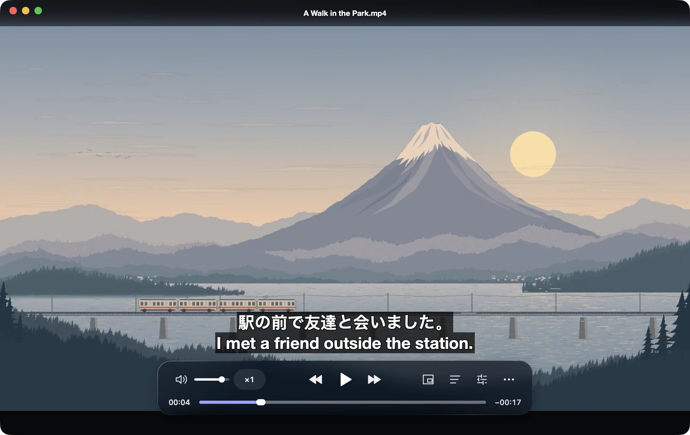
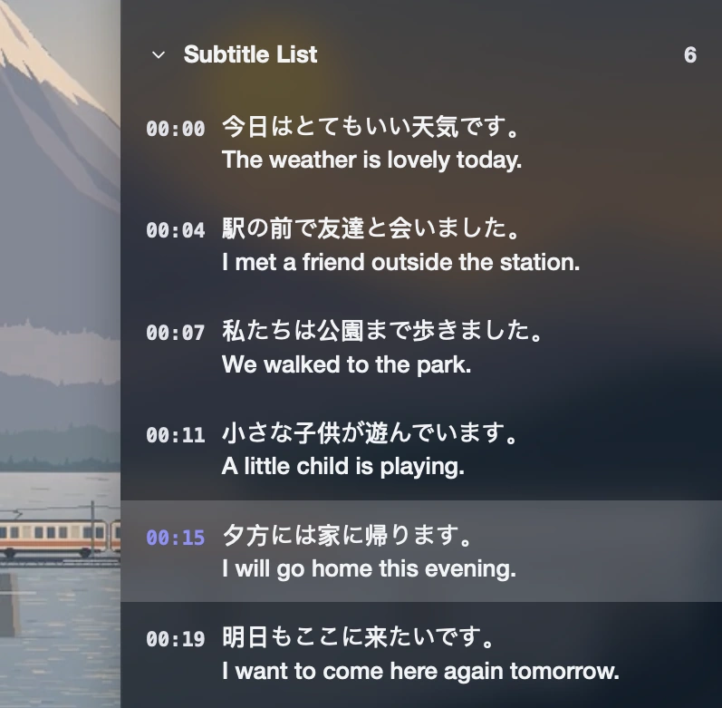
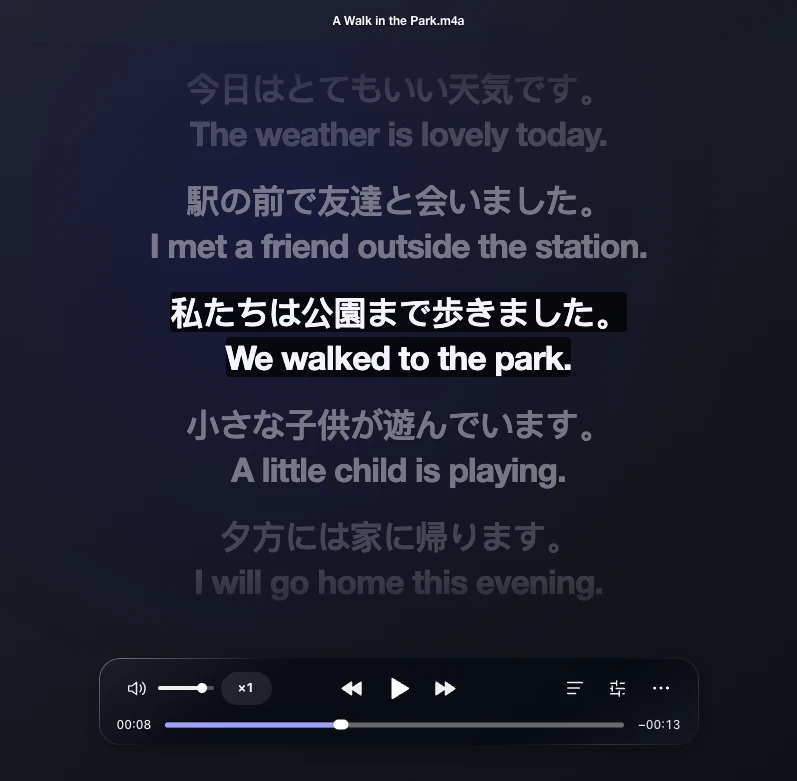

# Hen Local Player

Watch a video with the original dialogue and its translation on screen together. Hen Local Player transcribes and translates on your Mac, then saves the subtitles for the next time you watch.

**[Download for macOS](https://github.com/Hen-Local/Hen-Local-Player/releases/latest)** · Free and open source · Apple silicon · macOS 14 or later

## Try it

- **Play the sample.** Choose **••• → Play Sample** in the opening window to see bilingual subtitles in action.
- **Caption your own video.** Open a file and choose **Transcribe** in the **Subtitles** sidebar. Download the models when prompted. Transcription and translation then work offline.

| Browse subtitles and jump to a line | Follow along with an audio file |
| --- | --- |
|  |  |

[Player guide](docs/PLAYER.md) · [Build from source and use the CLI](docs/DEVELOPMENT.md) · [Apache 2.0 license](LICENSE) · [Third-party notices](docs/LICENSES.md)
