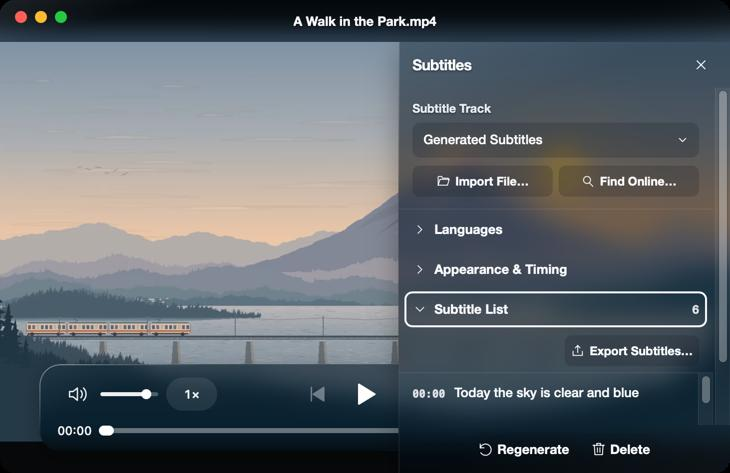
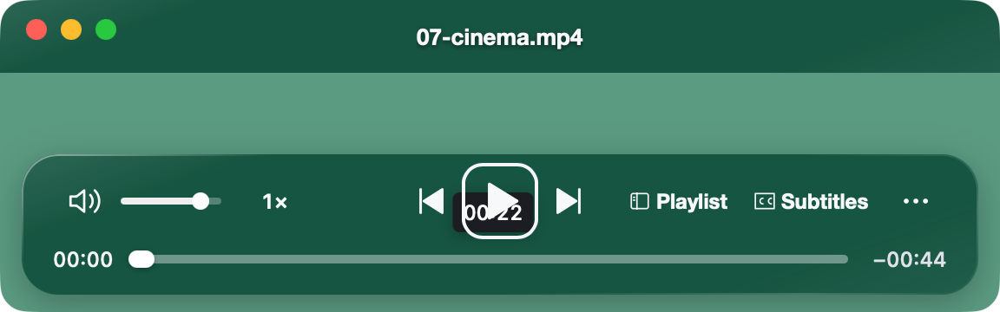

# Hen Local Player · macOS design audit

November 25, 2026 · Local version 0.2.1

The first fixes should protect existing subtitle files, keep Play/Pause and captions usable with an inspector open, and make caption size and styling respect the viewer’s needs. The strongest Mac integration opportunity is a separate Settings window, followed by a menu bar that accurately reflects the current file and available commands.

I reviewed the current working tree, the built Mac app’s accessibility tree and menus, and the project’s native captures of windowed, portrait, ultrawide, audio, and subtitle workflows. I used the workspace bundle for live checks. File-replacement findings come from tracing the write path. Font sizes and contrast ratios identified as calculations come from the current CSS. Spoken VoiceOver output, an actual AirPlay receiver, and every language and system-appearance combination remain device checks.

Apple publishes both platform conventions and recommendations that allow exceptions. The fixes below are specific design proposals. Items concerning the movie’s dark background, translucent controls, and compact layout take Apple’s media-viewing guidance into account.

## Playback and the picture

| # | What happens today | Proposed fix |
|---|---|---|
| 1 | **An open inspector covers the controls it helps you use.** In the 730-point capture below, Subtitles hides Next and the right end of Seek. At 450 points the right inspector is at least 260 points wide, enough to cover the centered Play button. Captions stay centered on the entire picture, so longer lines can run under the inspector. Covered controls remain in the keyboard order. | Preserve the movie’s aspect ratio. Lay out Play/Pause, the scrubber, and captions within the uncovered area while a panel is open. At the narrowest widths, move secondary actions into a menu or put the panel below the picture. Keep every focusable control visibly reachable. [Playing video][video] · [Layout][layout] |
| 2 | **The seek preview covers Play.** At the minimum cinema and portrait sizes, the timestamp above the timeline lands directly on the Play/Pause glyph. | Put the preview above the entire controller or in a reserved time-label area. Clamp it to both window edges. Check the center and both ends in portrait and cinema windows. [Playing video][video] · [Layout][layout] |
| 3 | **Scrubbing by keyboard is too fine to see.** A focused Seek slider moves in 50 ms steps, while its visible and spoken values show only whole seconds. Elsewhere the same arrow keys jump five seconds. | Use the same meaningful time step when Seek has focus. Keep a modified key for fine seeking and announce the finer value when used. [Keyboards][keyboard] · [Sliders][sliders] |
| 4 | **Crossing Speed or More Options opens interactive UI.** A mouse passing across the bar can reveal seven speed presets and a slider, or an output menu. Clicking Speed with a mouse still leaves dismissal tied to pointer exit. Hovering over Speed while the output menu is pinned can present both at once. | Use hover for a short label. Open the controls on click or keyboard activation. Present one at a time. Close on a second activation, Escape, or outside click, and restore focus to the trigger. [Popovers][popovers] · [Menus][menus] |
| 5 | **AirPlay is hidden behind a generic ellipsis and uses a hand-drawn symbol.** The app does open the system picker. Apple specifically calls for its supplied symbol in a custom AirPlay control. | Use the system route picker or the Apple-provided AirPlay symbol. Show connection state on the control and give it an output-specific accessible name. Put it directly on the bar when space permits. [AirPlay][airplay] |
| 6 | **A movie with multiple audio tracks has no track picker.** The backend exposes the tracks and the app has a switch-track operation. Neither Playback nor the onscreen controls reach it. The spoken-language selector configures recognition and cannot switch the soundtrack. | Add **Playback → Audio Track** and expose the same choice in playback options. List language and track title, mark the active track, and retain position and playback state when switching. Particularly important for dubbed and audio-description tracks. [Playing video][video] · [Accessibility][access] |
| 7 | **Removing the current playlist item can change the movie or close it immediately.** The row’s × has no queue undo. Removing the sole item also takes the window out of full screen. | Support **Undo Remove from Playlist**, restoring order and position. Keep the existing window in full screen when returning to the opening view until the viewer explicitly exits. Use **Remove from Playlist** in the row’s contextual menu. [Undo and redo][undo] · [Going full screen][full] |

Implementation evidence · [Inspector layout](../app/ui/src/styles.css) · [Transport](../app/ui/src/lib/Controls.svelte) · [Output menu](../app/ui/src/lib/PlaybackOutputs.svelte) · [Icon artwork](../app/ui/src/lib/Icon.svelte) · [Playback and queue state](../app/ui/src/lib/stores.svelte.ts).

## Subtitles, transcripts and accessibility

| # | What happens today | Proposed fix |
|---|---|---|
| 8 | **The main picture bypasses the viewer’s macOS caption style.** The video disables native text tracks for inline playback and draws its own white text, black stroke, relative font sizes and background. Picture in Picture uses a separate native text track. | Default to the person’s macOS caption preferences for supported attributes, including font, size, colors, edge and background. Apply them to both bilingual rows. Keep language order and per-movie timing available. Verify the same cue inline and in PiP. [Apple caption preferences][captions] · [Settings][settings] |
| 9 | **Bilingual captions can become smaller than the time display.** At the supported 576 × 180 cinema size and default scale, the current formula yields **7.56 and 6.12 CSS pixels**. Even a 300-point-high picture yields only 12.6 and 10.2. | Set a legibility floor for each row based on the preferred caption size. Rewrap or repaginate against the usable width. Test a long Chinese/English cue at minimum portrait and ultrawide sizes with controls both shown and hidden. [Accessibility][access] · [Typography][type] |
| 10 | **Audio transcript lines fade below readable contrast.** Distant rows are clickable at 21% opacity. Compositing the specified text over the declared dark background stop gives roughly **1.88:1**, before the edge mask fades it further. | Keep actionable lines legible. Distinguish the current phrase with weight, a marker or a background. Use the edge fade only beyond the readable rows. Test Increase Contrast as well as the default. [Accessibility][access] |
| 11 | **Large text and long transcript rows can lose content.** The general interface uses fixed pixel sizes, caption scale affects only subtitles, and virtualized transcript rows are fixed at 88 px with overflow hidden. Long bilingual lines can be cut off even when the list scrolls. | Use system text styles for interface labels and honor text enlargement and the Mac sidebar-size preference. Measure virtualized rows at the actual width and text size, or allow a row to expand. Check long lines in both languages at 200% interface text. [Accessibility][access] · [Sidebars][sidebar] |
| 12 | **Keyboard browsing competes with playback.** Playlist and transcript rows are buttons, but the global arrow handler still seeks or changes volume on those rows. Transcript auto-follow briefly pauses for pointer input only. In the audio view, only the anchor lyric is tabbable and there is no row-navigation handler. | Let a focused list own Up/Down, Home/End and activation. Suspend auto-follow while someone browses with a keyboard or assistive technology. Provide **Follow Playback** to return to the current line. [Keyboards][keyboard] · [Focus and selection][focus] |
| 13 | **Bilingual text loses its language in the accessibility tree.** Caption and transcript rows have automatic text direction, but no per-row language. The native tree exposed the Chinese and English from one onscreen cue together. | Preserve the known original and translation language tags on each row in video, transcript and audio views. Keep the transcript navigable and test pronunciation with VoiceOver without announcing every playing cue by default. [VoiceOver][vo] |
| 14 | **Some playback states rely on color or shading.** Current playlist and transcript rows use tints. Repeat All uses the same glyph as Repeat Off. The two-pixel timeline strip encodes transcription and translation coverage by color and is hidden from accessibility. The panel’s percentages describe overall progress, not the position being inspected. | Give the current item a playing marker and Repeat an explicit state. Provide a short text equivalent for coverage at the inspected time, with a pattern or distinct shapes where practical. Retain the overall progress summary. [Accessibility][access] · [Color][color] |
| 15 | **The transcript destination does not open the transcript.** In the native app, **Subtitles → Subtitle List** opened the sidebar and left **Subtitle List · 327 lines** collapsed. The T shortcut calls the same panel logic. | Expand the list, scroll the current cue into view, and move focus to the cue or list heading. If there is no transcript, show the relevant empty state. Give **Show Subtitles Panel** its own command. [Menus][menus] · [Focus and selection][focus] |
| 16 | **Automatic-update and panel accessibility names can be misleading.** In the native tree the update checkbox was named by its explanatory sentence, while “Download Updates Automatically” appeared separately. An open inspector also exposed two controls named “Close,” including the transparent click-away surface. | Give the checkbox an explicit visible label and expose the explanation only as its description. Name the visible buttons **Close Playlist** and **Close Subtitles**. Make the pointer-only dismissal surface decorative to assistive technology. [VoiceOver][vo] |

Implementation evidence · [Video and PiP tracks](../app/ui/src/lib/Player.svelte) · [Caption sizes](../app/ui/src/lib/SubtitleOverlay.svelte) · [Caption rows](../app/ui/src/lib/CaptionRows.svelte) · [Audio transcript](../app/ui/src/lib/AudioLyrics.svelte) · [Transcript list](../app/ui/src/lib/TranscriptPanel.svelte) · [Coverage strip](../app/ui/src/lib/SeekCoverage.svelte) · [Update checkbox](../app/ui/src/lib/SoftwareUpdate.svelte) · [Global shortcuts and panel focus](../app/ui/src/App.svelte).

## Files, downloads and destructive actions

| # | What happens today | Proposed fix |
|---|---|---|
| 17 | **Batch export can replace existing subtitle files without asking.** “Export All to Video Folder” derives up to nine filenames beside the movie and writes directly. An edited file such as `Movie.en.srt` is a possible collision. | Keep the video folder as a convenient default. Before writing, identify conflicts and offer **Keep Both**, **Replace**, or **Cancel**. Show which files will be affected. Use a non-replacing write for new files so a file created after the check also stays safe. [File management][files] · [Alerts][alerts] |
| 18 | **Export can mean a different track than the one being watched.** The transcript hides Export on an imported track, but the menu allows export for any open media. The writer renders the generated timeline, so an authored-track viewer can get another transcript or an empty export. | Label the command **Export Generated Subtitles…** and enable it only when generated cues exist, or explicitly name and export the selected track. For a single export, put the format and language choices in the native Save sheet. Canceling the Save panel should return to any choices the user still needs. [Menus][menus] · [File management][files] |
| 19 | **Regenerate immediately invalidates the saved result.** Delete asks first, but the adjacent Regenerate button resets the existing transcript and invalidates its translations before replacement finishes. | Generate a replacement separately and keep the previous result until success. If a rebuild must discard the old result immediately, identify the track and consequence and offer **Cancel** and **Regenerate** first. [Undo and redo][undo] · [Alerts][alerts] |
| 20 | **Clear Cache uses an armed button with the same label.** The first click adds a warning underneath, and the second click runs deletion. There is no explicit Cancel in the confirmation. Inactive media can lose cached transcripts as well as prepared video. | Show a standard destructive confirmation with **Cancel** and **Clear Cache**. State whether saved generated subtitles are included. If feasible, let people clear prepared video while retaining transcripts. [Alerts][alerts] |
| 21 | **Clicking outside a modal sheet can discard input or cancel work.** The shared dialog closes on a backdrop click. In Open URL, closing during a download calls the cancel operation. | Keep outside clicks inert for task sheets. Use explicit **Cancel** and Escape where appropriate. During transfer, distinguish **Stop Download** from hiding progress or returning to playback. [Modality][modality] · [Sheets][sheets] |
| 22 | **⌘L does not put the cursor in the URL field.** In the native app, opening the sheet placed focus on the “Open URL” heading. An immediate paste therefore misses the field. | Focus the URL field when the sheet opens. Keep Return for Preview or Download. Use the working online-subtitle search field as the implementation precedent. [Text fields][fields] · [Focus and selection][focus] |
| 23 | **The download destination requires typing a filesystem path.** Storage shows an editable path with no folder chooser. | Show the current destination and a **Choose Folder…** button backed by the native directory picker. Validate the chosen folder and explain any write-permission problem in place. [Path controls][paths] · [File management][files] |
| 24 | **Settings can swallow success feedback.** Updating the URL tool and clearing the cache send a temporary notice, but the app renders notices only when no dialog is open. The action can succeed while the person waits for confirmation. | Show the result beside the initiating button, including the new cache size or tool status. Expose the result as an accessible status message while Settings stays open. [Feedback][feedback] |
| 25 | **Model setup and URL downloads expose uneven feedback.** Setup tooltips say “Retry” even before a first download, accessible names contain component IDs, and the setup and URL progress bars have no associated accessible name. Some setup and URL failures expose raw diagnostic text. | Label each tool by purpose, with the technical name as detail. Match Download/Retry to state, name progress indicators for the operation, and show a localized recovery action. Offer technical details separately. [Progress indicators][progress] · [VoiceOver][vo] · [Writing][writing] |
| 26 | **Long-running subtitle generation has no visible pause or stop action.** The progress view shows stages and percentages, with Resume/Retry available in certain later states. The generation action and status also sit at the very bottom of the inspector, where a partly offscreen window can hide them. | Add **Pause Generation** beside progress and **Resume** when paused. Keep completed cues and the current playback position. Put the primary Generate or Pause action in a reliably visible panel header and mirror it in the Subtitles menu. [Progress indicators][progress] · [Sidebars][sidebar] |
| 27 | **Finishing one export changes a global preference.** Choosing **Export When Complete** on an incomplete export enables **Process the Entire File** in Settings for future movies. The queued export belongs to the current session and is cleared when another file opens. | Treat finishing as a one-job override. Keep a visible pending export with its movie and destination. If switching files will cancel it, say so before switching or let the job finish independently. [Settings][settings] · [Feedback][feedback] |

Implementation evidence · [Export decisions](../app/ui/src/lib/ExportMenu.svelte) · [Output filenames and cache clearing](../app/src/commands.rs) · [Export writer](../crates/hlp-pipeline/src/session.rs) · [Atomic replacement and eviction](../crates/hlp-pipeline/src/store.rs) · [Regeneration](../crates/hlp-pipeline/src/timeline.rs) · [Dialog dismissal](../app/ui/src/lib/Dialog.svelte) · [Open URL](../app/ui/src/lib/OpenUrlDialog.svelte) · [Model setup](../app/ui/src/lib/SetupScreen.svelte) · [Generation progress](../app/ui/src/lib/SubtitleProgress.svelte).

## Mac windows, menus and appearance

| # | What happens today | Proposed fix |
|---|---|---|
| 28 | **Settings blocks the player and forgets its pane.** ⌘, opens a modal inside the movie window. Settings uses a category sidebar, keeps the generic title, and initializes on General each time. A welcome-window gear duplicates the app menu. | Open a single independent Settings window from the app menu and ⌘,. Use a fixed General / Processing / Storage toolbar, indicate the active pane, update the title, and restore the last pane. The player should remain usable while Settings is open. Remove the redundant gear from the window frame. [Settings][settings] |
| 29 | **The native window is named “Hen Local Player” even with a movie open.** The onscreen title and web content knew the filename, but the native accessibility window and its Window-menu entry still showed only the app name. | Set the native window title to the media filename and the represented file URL for local files. Restore the app name at the welcome screen. Verify the Window menu and the accessibility window title. [Windows][windows] · [The menu bar][bar] |
| 30 | **The menu bar puts Playback and Subtitles before Edit and View.** The app also places About and Settings in the same group, omits Show All from the constructed app menu, and labels the native Zoom action “Maximize.” | Use **App, File, Edit, View, Playback, Subtitles, Window, Help**. Use the platform’s standard application and window commands and labels. Put a separator after About and restore Show All. [The menu bar][bar] |
| 31 | **Menu availability and keyboard shortcuts disagree with the player.** For example, Previous and Next are validated in the transport, but are always enabled in the menu. Play / Pause is a static combined label. Speed, Mute and several working keyboard commands have no menu equivalents. ⌘E for Export takes Apple’s standard Use Selection for Find shortcut. | Drive menus and controls from the same enabled and checked state. Name Play/Pause for the next action. Expose speed, sound, seeking, panel visibility and applicable output commands in the menu, and display their shortcuts. Choose a nonconflicting export shortcut and update the guide. [The menu bar][bar] · [Keyboards][keyboard] |
| 32 | **File opening and recent history take extra interpretation.** The welcome and ⌘O command read “Open File / Open Folder” even though one Mac picker accepts both. File → Recently Opened takes the person to another view instead of presenting filenames in the menu. The in-player recent list gives audio files a film icon. | Use **Open…** for the combined picker. Add **File → Open Recent** with filenames, most recent first, and **Clear Menu**. Reuse the welcome list’s audio/video icon logic. For the action that reveals a file, use **Show in Finder**. [The menu bar][bar] · [File management][files] |
| 33 | **Help has no player guide, and the welcome ⓘ opens GitHub.** An information symbol gives little indication that the person is leaving the app for a source repository. | Put the existing guide under **Help → Hen Local Player Help** and add **Keyboard Shortcuts**. Give the external destination an explicit **Project on GitHub** label in Help or About. [Offering help][help] · [Buttons][buttons] |
| 34 | **Utility windows force Dark appearance and a custom accent.** The Mac window forces Dark and the app defaults to blue with four fixed tint choices. This also affects Settings, setup and file tasks. Apple allows a permanent dark presentation for immersive media. | Keep the movie canvas dark. Let welcome, Settings and utility sheets follow system appearance and use the system control accent by default. A brand color can still identify Hen Local or serve as an explicit override. [Dark Mode][dark] · [System accent color][accent] |
| 35 | **Text-heavy inspectors use the same glass treatment as playback controls.** Movie detail can show through track selectors and transcript rows. The app already has opaque accessibility fallbacks. | Keep the lightest material on the short transport overlay. Use a more opaque regular material or semantic surface behind text-heavy inspectors and sheets. Check small text against bright, dark and moving frames with Increase Contrast and Reduce Transparency individually. [Materials][materials] · [Accessibility][access] |
| 36 | **Arabic and Persian only partially adapt.** Text direction changes, but the playlist is fixed to the physical left, the subtitle inspector to the physical right, and the volume group is forced left-to-right. Download sizes and many percentages use manually assembled numbers. | Use leading/trailing placement for navigation and inspectors, mirror the volume slider as Apple illustrates, and format sizes, percentages and decimals using the selected locale. Review media time and playback symbols separately with native conventions. [Right to left][rtl] |
| 37 | **Two small sidebar controls favor visual size over ease of pointing.** Subtitle appearance sliders have a 20 px interaction height and the reset buttons are 26 × 26. These are below Apple’s default 28 × 28-point Mac control size. The 20-point slider still reaches Apple’s minimum. | Enlarge the hit areas to at least the default where space permits. Keep the track and glyph visually compact. Verify the whole target with accessibility hit-testing. [Accessibility][access] |

Implementation evidence · [Native menus](../app/src/player_menu.rs) · [Menu labels and shortcuts](../app/ui/src/lib/i18n/native-menu.ts) · [Mac window configuration](../app/tauri.macos.conf.json) · [Settings panes](../app/ui/src/lib/SettingsDialog.svelte) · [Welcome and key handling](../app/ui/src/App.svelte) · [Recent list](../app/ui/src/lib/RecentList.svelte) · [Sidebar styles](../app/ui/src/lib/player-panels.css) · [Appearance sliders](../app/ui/src/lib/SubtitleAppearance.svelte) · [Number formatting](../app/ui/src/lib/format.ts).

## Fix order and acceptance

1. **Protect saved work.** Seed a disposable movie folder with an edited SRT and generate a second transcript. Batch export, canceling an export, and a failed regeneration should preserve the original until the viewer explicitly chooses replacement. Check exporting with an imported track selected.
2. **Make the compact player usable.** Check 450 × 300, 720 × 430, minimum ultrawide and portrait sizes. With each panel open, play, pause, seek, read both languages and close the panel with pointer and keyboard. Verify that no clipped control receives invisible focus.
3. **Honor the viewer’s reading settings.** Test a custom macOS caption style, larger text, Increase Contrast, Reduce Transparency and VoiceOver. Include mixed-language dialogue, distant audio lines, and a long transcript entry. Test PiP and AirPlay on supported hardware.
4. **Finish Mac navigation.** From a closed panel, use Subtitle List. From playback, use ⌘L and immediately paste. Reopen Settings after choosing Storage. Check menus with no file, a single item, a multi-item queue and an imported track. Verify light and dark appearances and Arabic/Persian navigation.

[access]: https://developer.apple.com/design/human-interface-guidelines/accessibility
[airplay]: https://developer.apple.com/design/human-interface-guidelines/airplay
[alerts]: https://developer.apple.com/design/human-interface-guidelines/alerts
[bar]: https://developer.apple.com/design/human-interface-guidelines/the-menu-bar
[buttons]: https://developer.apple.com/design/human-interface-guidelines/buttons
[captions]: https://developer.apple.com/documentation/mediaaccessibility/captions
[color]: https://developer.apple.com/design/human-interface-guidelines/color
[dark]: https://developer.apple.com/design/human-interface-guidelines/dark-mode
[feedback]: https://developer.apple.com/design/human-interface-guidelines/feedback
[fields]: https://developer.apple.com/design/human-interface-guidelines/text-fields
[files]: https://developer.apple.com/design/human-interface-guidelines/file-management
[focus]: https://developer.apple.com/design/human-interface-guidelines/focus-and-selection
[full]: https://developer.apple.com/design/human-interface-guidelines/going-full-screen
[help]: https://developer.apple.com/design/human-interface-guidelines/offering-help
[keyboard]: https://developer.apple.com/design/human-interface-guidelines/keyboards
[layout]: https://developer.apple.com/design/human-interface-guidelines/layout
[materials]: https://developer.apple.com/design/human-interface-guidelines/materials
[menus]: https://developer.apple.com/design/human-interface-guidelines/menus
[modality]: https://developer.apple.com/design/human-interface-guidelines/modality
[paths]: https://developer.apple.com/design/human-interface-guidelines/path-controls
[popovers]: https://developer.apple.com/design/human-interface-guidelines/popovers
[progress]: https://developer.apple.com/design/human-interface-guidelines/progress-indicators
[rtl]: https://developer.apple.com/design/human-interface-guidelines/right-to-left
[settings]: https://developer.apple.com/design/human-interface-guidelines/settings
[sheets]: https://developer.apple.com/design/human-interface-guidelines/sheets
[sidebar]: https://developer.apple.com/design/human-interface-guidelines/sidebars
[sliders]: https://developer.apple.com/design/human-interface-guidelines/sliders
[type]: https://developer.apple.com/design/human-interface-guidelines/typography
[undo]: https://developer.apple.com/design/human-interface-guidelines/undo-and-redo
[video]: https://developer.apple.com/design/human-interface-guidelines/playing-video
[vo]: https://developer.apple.com/design/human-interface-guidelines/voiceover
[windows]: https://developer.apple.com/design/human-interface-guidelines/windows
[writing]: https://developer.apple.com/design/human-interface-guidelines/writing
[accent]: https://developer.apple.com/documentation/swiftui/color/accentcolor
